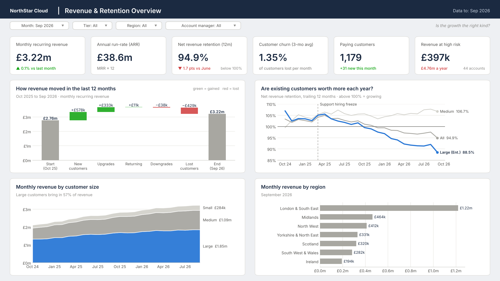
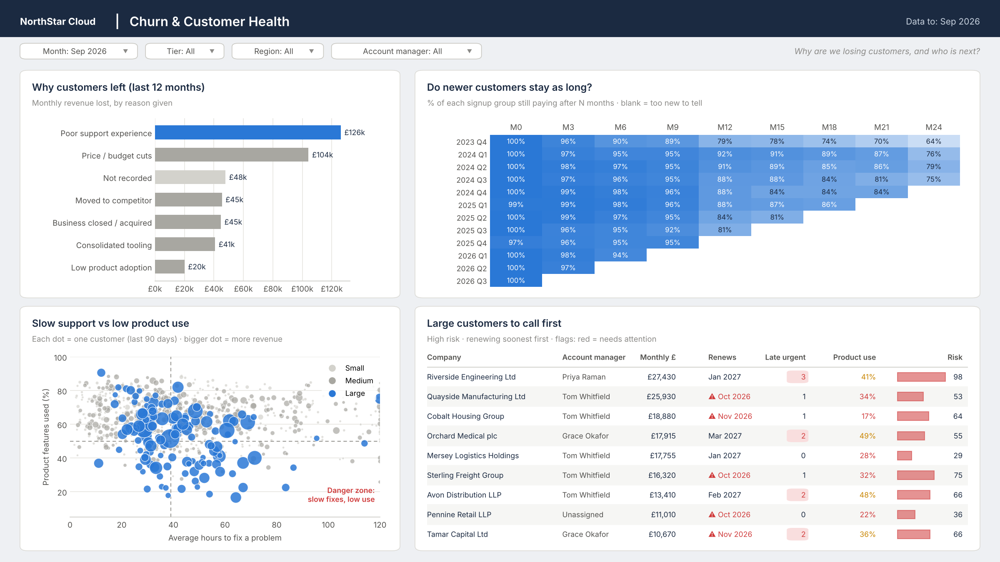
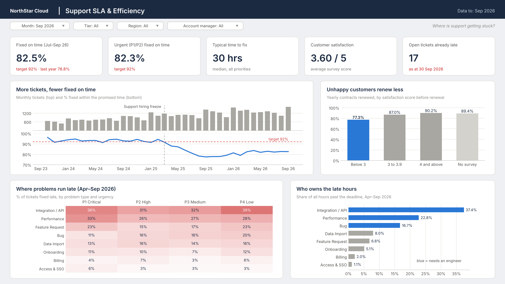
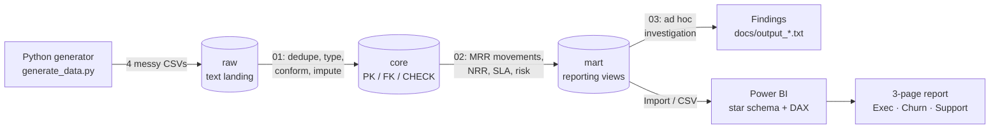

# NorthStar Cloud — SaaS Revenue, Retention & Support Analytics

**SQL (PostgreSQL) · Python · Power BI · DAX**

An end-to-end analytics project for a fictional UK B2B SaaS company that kept growing its headline revenue while its existing customer base quietly started shrinking. I built the data, the warehouse, the metric layer and a three-page Power BI report, and used them to answer one question the leadership team couldn't agree on:

> *Is the support backlog actually costing us customers, and if so, how much?*

Short answer: yes. Accounts that suffer three or more P1/P2 SLA breaches in a quarter are **3.6× more likely to churn** in the following six months. Right now that puts about **£271k of ARR** at avoidable risk, on top of a further **£2.7m** of high-risk Enterprise ARR coming up for renewal in the next six months.

> **Note on the data:** the data is synthetic. A Python generator simulates three years of CRM, billing, helpdesk and product-usage extracts, with realistic seasonality, messy source data and cause-and-effect built in (slow support → lower health → churn at renewal). The numbers below come from running the SQL in this repo against that data, not from any real company.

📄 **Full project report (plain English, 11 pages):** [docs/NorthStar_Cloud_Project_Report.pdf](docs/NorthStar_Cloud_Project_Report.pdf)

---

## Executive summary

**The situation.** NorthStar Cloud (Manchester, £38.6m ARR, 1,179 customers) froze support hiring in March 2025. MRR still grew 16% over the last year, so the board pack looked healthy. Underneath it:

- **Net revenue retention fell from 104.1% to 94.9%** (Mar 2025 → Sep 2026). Enterprise fell harder, from 105.0% to 88.5%. Mid-Market held up at 106.7%, so the problem is concentrated in the segment with 57% of revenue.
- **Enterprise logo churn nearly tripled**, from 5.4% to 15.6% a year (annualised).
- **Churned MRR over the last 12 months was £429k**, three times the £143k of a year earlier. Churn and downgrades now cancel out **81p of every £1 of new MRR**. In the year to March 2025 it was 21p.
- **SLA compliance dropped from 93% to 78%** within six months of the freeze and is still only 82.5%, against a 92% target.

**What I found.** The SLA problem and the retention problem are the same problem. The damage is concentrated in Engineering-escalated tickets (Integration/API, Performance, Bug), which own **77% of all hours over SLA**. Enterprise customers raise more of exactly those tickets.

**What I'd recommend.** Ring-fence Engineering escalation capacity, route Enterprise P1/P2s to named engineers, and run a renewal programme for the 19 high-risk Enterprise accounts renewing in the next six months. Details and figures below.

---

## Key insights

### 1. Repeated high-priority breaches predict churn, with a clear threshold
Every account live at the start of each quarter, its P1/P2 breaches that quarter, and whether it churned in the *following* six months (8,475 account-quarters, using only quarters with a complete look-ahead):

| P1/P2 breaches in a quarter | Churn in next 6 months | vs baseline |
|---|---|---|
| 0 | 7.0% | 1.0× |
| 1 | 8.2% | 1.2× |
| 2 | 10.8% | 1.5× |
| **3+** | **25.5%** | **3.6×** |

For Enterprise only, it's 26.8% vs 5.1%. One bad ticket is forgiven; a pattern isn't. *(`sql/03_ad_hoc_investigation.sql`, Q3)*

### 2. Low CSAT shows up at the renewal table
Annual renewal rate is **77.3%** where average CSAT in the six months before renewal was below 3.0, against **90.2%** where it was 4.0 or above. *(`mart.fact_renewals`)*

### 3. The bottleneck is Engineering escalation, not the front line
Comparing the same six months before (Apr–Sep 2024) and after (Apr–Sep 2026) the freeze:

| Queue | Breach rate before → after | P90 resolution (hrs) | Share of all hours over SLA (now) |
|---|---|---|---|
| Integration / API | 14.7% → **33.3%** | 89 → 133 | **37.4%** |
| Performance | 10.5% → 27.3% | 75 → 122 | 22.8% |
| Bug | 6.4% → 17.4% | 69 → 103 | 16.7% |
| Billing, Access & SSO (Tier 1) | ~1% → 3–5% | – | 3.1% combined |

Tier 1 is coping. The overrun sits with the work that needs an engineer. *(Q4)*

### 4. Newer cohorts retain worse
12-month logo retention was 92.0% for customers who joined in Q1 2024 and 80.5% for the Q3 2025 cohort, who onboarded during the freeze. *(Q1 cohort analysis)*

### 5. Churners look different months before they leave
Accounts that went on to churn averaged about 58% feature adoption for the six months before leaving, against 65% across all accounts. The gap is a steady level difference, not a sudden drop, so a **threshold alert** (adoption below 50%) will catch them earlier than a trend alert.

### 6. We don't always know why customers leave
**11% of churned MRR** in the last 12 months has no churn reason recorded. Where a reason was recorded, MRR lost to "poor support experience" more than doubled year on year (£58k → £126k).

---

## Recommendations

| # | Action | Owner | Why / size of the prize |
|---|---|---|---|
| 1 | **Ring-fence an Engineering escalation rota** for Integration/API and Performance tickets, with an agreed weekly capacity | CTO, Head of Support | These queues hold 60% of late hours. Getting P1/P2 compliance back to 92% removes the main churn driver |
| 2 | **Enterprise priority routing:** any Enterprise P1/P2 at 50% of its SLA auto-escalates to a named engineer; the CSM is alerted on the second breach in a quarter | Head of Support | 8 live accounts already have 3+ breaches this quarter (£1.47m ARR). At 25.5% vs 7.0% churn, that's **~£271k of excess ARR at risk** over six months |
| 3 | **Renewal programme** for the 19 high-risk Enterprise accounts renewing in the next six months: exec sponsor call and service review 90 days before renewal | VP Customer Success | **£2.69m ARR** up for renewal. The call list with suggested next steps is in Q2 and on Page 2 |
| 4 | **Adoption alert at 50%** for Mid-Market and Enterprise, triggering a CSM re-onboarding plan | Customer Success Ops | Churners sit ~7 points below average adoption for 6+ months, which is plenty of time to act |
| 5 | **Make churn reason mandatory** in the CRM, with a fixed pick-list | RevOps | 11% of lost MRR is unexplained. You can't fix what you can't see |

The £271k is a simple expected-value estimate (ARR × excess churn probability). I'd validate it with a three-month routing pilot before putting it in a budget case.

---

## Dashboard

Three pages, one per leadership conversation. These images show the dashboard design with the September 2026 figures, drawn directly from the project's data. The full layout spec is in [docs/05_dashboard_wireframe.md](docs/05_dashboard_wireframe.md).

**Page 1: Revenue & Retention.** Is the growth the right kind?


**Page 2: Churn & Customer Health.** Why are customers leaving, and who is next?


**Page 3: Support SLA & Efficiency.** Where is support getting stuck?


---

## Architecture



```
Python ETL  ─►  SQL warehouse (raw ─► core ─► mart)  ─►  Power BI semantic model  ─►  Report
```

- **raw** holds the extracts exactly as they arrived, all as text, so a bad value never breaks the load.
- **core** is the single source of truth: typed, de-duplicated, constrained, with every cleaning step counted in `core.v_data_quality_report`.
- **mart** holds the business definitions. Power BI imports these views and adds only time intelligence and slicing, so a metric means the same thing in SQL and in the report.

---

## Repository structure

```
northstar-saas-analytics/
├── README.md
├── requirements.txt
├── scripts/
│   └── run_pipeline.sh              # one command: generate → load → clean → model → export
├── python/
│   └── generate_data.py             # synthetic data generator (seeded, deterministic)
├── data/
│   ├── raw/                         # the 4 messy source extracts
│   └── marts/                       # mart views exported to CSV (Power BI without Postgres)
├── sql/
│   ├── 00_load_raw.sql              # land CSVs as text
│   ├── 01_schema_and_cleaning.sql   # DDL, PK/FK, dedupe (ROW_NUMBER), cleaning, DQ report
│   ├── 02_business_logic_views.sql  # MRR bridge, NRR/GRR, churn, SLA, renewals, account health
│   └── 03_ad_hoc_investigation.sql  # cohorts, at-risk accounts, breach→churn, bottlenecks
├── powerbi/
│   ├── measures.dax                 # all DAX measures, with comments and format strings
│   ├── dim_date.dax                 # calculated date table (UK fiscal year)
│   └── northstar_theme.json         # report theme
└── docs/
    ├── 01_business_context.md       # company, pain points, the 5 executive questions
    ├── 02_data_dictionary.md        # raw columns, known data issues, warehouse layers
    ├── 04_powerbi_data_model.md     # star schema, relationships, build steps
    ├── 05_dashboard_wireframe.md    # page-by-page visual spec
    ├── NorthStar_Cloud_Project_Report.pdf  # plain-English project report
    ├── images/                      # dashboard page images
    ├── output_data_quality_report.txt
    └── output_ad_hoc_investigation.txt
```

---

## How the metrics are defined

| Metric | Definition |
|---|---|
| MRR | Recurring subscription revenue billed in the month (GBP) |
| New / Expansion / Contraction / Churned / Reactivation MRR | Month-on-month change per account, classified in `mart.fact_mrr_movements`. The bridge reconciles to £0.00 every month, and the pipeline fails if it doesn't |
| Logo churn % | Accounts lost in the month ÷ accounts live at the start of the month |
| NRR (TTM) | MRR today from accounts that were live 12 months ago ÷ their MRR then. Includes expansion, excludes new logos |
| GRR (TTM) | As NRR, with each account capped at its starting MRR |
| SLA compliance | Tickets resolved within SLA ÷ tickets whose outcome is known. Open tickets count as breached once they pass their SLA |
| High-risk account | 2+ P1/P2 breaches in 90 days *and* adoption below 50%, or adoption below 35% over 13 weeks. The same rule runs in SQL and DAX |

## Data quality handled

From `docs/output_data_quality_report.txt`:

| Issue | Rows fixed |
|---|---|
| Duplicate CRM records (kept the most complete) | 23 |
| Internal test accounts excluded, plus their 6 orphan billing rows | 3 |
| UK-format `DD/MM/YYYY` signup dates parsed | 110 |
| Currency-formatted MRR (`£1,234.00`) converted | 1,010 |
| Missing MRR carried forward from the prior month (window-function fill) | 133 |
| Duplicate billing re-syncs removed | 399 |
| Duplicate ticket webhooks removed (kept the latest state) | 739 |
| Tickets resolved before they were created (flagged, excluded from SLA) | 110 |
| Telemetry: duplicate snapshots, negative API counts, adoption sent as 0–1 | 2,153 / 434 / 2,906 |

---

## Reproduce it locally

**You need:** Python 3.10+, PostgreSQL 14+ (with `psql` on your PATH) and Power BI Desktop (Windows) for the report.

```bash
git clone https://github.com/<your-username>/northstar-saas-analytics.git
cd northstar-saas-analytics
pip install -r requirements.txt

# point at your Postgres server (defaults shown), then run everything
export PGHOST=localhost PGUSER=postgres PGDATABASE=northstar
./scripts/run_pipeline.sh
```

That takes around 30 seconds. It regenerates the data (same seed, same numbers), builds the `raw`, `core` and `mart` schemas, writes the investigation results to `docs/`, exports the marts to `data/marts/`, and checks that the MRR bridge reconciles.

To run a step by hand: `psql -f sql/02_business_logic_views.sql`. To try a different scenario: `SEED=7 ./scripts/run_pipeline.sh`.

**Power BI:** follow `docs/04_powerbi_data_model.md`. Connect to the `mart` views (or load `data/marts/*.csv`), build the relationships, paste in `powerbi/measures.dax`, then lay out the pages from `docs/05_dashboard_wireframe.md`. Expected headline values to check against: Total MRR £3,220,685 and NRR (TTM) 94.9% for September 2026.


---

## Techniques used

- **SQL:** CTE pipelines; `ROW_NUMBER()` de-duplication with completeness ranking; `LAG` / `LEAD` for MRR movement classification and churn look-ahead; `SUM() OVER` rolling windows; `COUNT() OVER` + `FIRST_VALUE` to carry missing values forward; `GROUPING SETS`; `PERCENTILE_CONT`; `LATERAL` joins; `FILTER` aggregates; PK/FK/CHECK constraints; a reconciling MRR bridge
- **Python:** a month-by-month simulation with latent customer health, plus deliberate messy-data injection
- **Power BI / DAX:** star schema with single-direction filters, semi-additive balance measures, TTM retention via `CALCULATETABLE`, `FILTER` with context transition for the risk measure, a disconnected table driving the waterfall, cohort heatmap
- **Analysis:** cohort retention, a leading-indicator study with a clean look-ahead window, before/after comparison controlling for seasonality, and an expected-value estimate of ARR at risk

## What I'd do next

- Replace calendar-hour SLAs with business hours for P3/P4 using a working-hours calendar table
- Fit a simple churn model (logistic regression on breaches, adoption and CSAT) and compare it with the rule-based risk band
- Schedule the pipeline (dbt + Airflow, or Fabric) with tests on the reconciliation and PK uniqueness
- Add row-level security so each account manager sees only their own book

---

**Sidhanth Chavan** · MSc Data Science (Distinction), Manchester Metropolitan University
[LinkedIn](https://www.linkedin.com/in/<your-profile>) · [Email](mailto:<you@example.com>)
