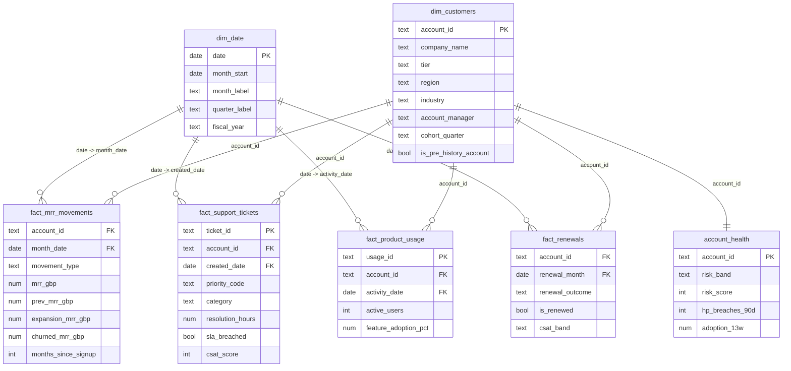

# Power BI semantic model

The model is a star schema built on the `mart` views. Every business rule (what counts as churn, how NRR is calculated, when a ticket has breached) is defined once in SQL. Power BI's job is slicing and time logic, not re-deriving definitions.

## Diagram

## Tables

| Table in Power BI | Source | Grain | Role |
|---|---|---|---|
| `dim_date` | `powerbi/dim_date.dax` (or `mart.dim_date`) | 1 day | Date dimension, marked as date table |
| `dim_customers` | `mart.dim_customers` | 1 account | Customer dimension: tier, region, industry, AM, cohort |
| `fact_mrr_movements` | `mart.fact_mrr_movements` | 1 account × 1 month | Revenue balances and MRR movements |
| `fact_support_tickets` | `mart.fact_support_tickets` | 1 ticket | Volume, SLA, resolution time, CSAT |
| `fact_product_usage` | `mart.fact_product_usage` | 1 account × 1 week | Active users, API calls, adoption |
| `fact_renewals` | `mart.fact_renewals` | 1 annual renewal decision | Renewal outcome with prior support experience |
| `account_health` | `mart.v_account_health` | 1 live account (snapshot) | Risk band and score for the action table |
| `Bridge Steps` | DAX `DATATABLE` | 6 rows | Disconnected, drives the MRR waterfall |
| `_Measures` | Empty table | – | Holds all measures, in display folders |

## Relationships

All relationships are **single direction** (dimension filters fact). No bi-directional filters: they cause ambiguous paths once there are several facts, and nothing in this report needs them.

| From (one side) | To (many side) | Cardinality | Cross-filter | Notes |
|---|---|---|---|---|
| `dim_date[date]` | `fact_mrr_movements[month_date]` | 1 : * | Single | Month facts sit on the 1st of the month |
| `dim_date[date]` | `fact_support_tickets[created_date]` | 1 : * | Single | Tickets dated by when they were raised |
| `dim_date[date]` | `fact_product_usage[activity_date]` | 1 : * | Single | Weekly (Monday) snapshots |
| `dim_date[date]` | `fact_renewals[renewal_month]` | 1 : * | Single | |
| `dim_customers[account_id]` | `fact_mrr_movements[account_id]` | 1 : * | Single | |
| `dim_customers[account_id]` | `fact_support_tickets[account_id]` | 1 : * | Single | |
| `dim_customers[account_id]` | `fact_product_usage[account_id]` | 1 : * | Single | |
| `dim_customers[account_id]` | `fact_renewals[account_id]` | 1 : * | Single | |
| `dim_customers[account_id]` | `account_health[account_id]` | 1 : 1 | **Single** (change from the default "Both") | Snapshot table, not date-aware |

`Bridge Steps` has no relationships.

## Build steps

1. **Get data → PostgreSQL database**, server `localhost`, database `northstar`. Choose **Import**. Select the `mart` views above.
   No PostgreSQL? Run `scripts/run_pipeline.sh` once (it exports every mart view to `data/marts/*.csv`) and use **Get data → Text/CSV** instead.
2. Rename the queries to the table names in the table above.
3. In Power Query, check types: dates as **Date** (not Date/Time), MRR columns as **Fixed decimal number**, flags as **True/False**.
4. Create `dim_date` from `powerbi/dim_date.dax`. **Mark as date table** on `dim_date[date]`. Turn off *Auto date/time* in Options.
5. Create the relationships above, then fix the 1:1 to single direction.
6. Create `_Measures`, paste in `powerbi/measures.dax`, set format strings and display folders.
7. Sort `month_label` and `quarter_label` by `year_month_key`. Sort `tier` by `tier_sort`.
8. Hide every foreign key and every raw numeric column that has a measure equivalent (e.g. hide `mrr_gbp`, so nobody drags in a summed MRR across months by accident).

## Modelling decisions worth explaining in an interview

- **MRR is semi-additive.** Summing MRR across twelve months gives a number that means nothing. `Total MRR (£)` returns the balance for the last month in context, and every movement measure (new, expansion, churn) is a straightforward sum.
- **One account-month fact instead of separate fact tables per movement type.** The bridge stays reconcilable: opening + movements = closing, and `mart.v_mrr_bridge_monthly.bridge_check_gbp` proves it is £0 every month.
- **The renewals fact exists so the CSAT question can be answered honestly.** Correlating CSAT with monthly churn mixes monthly-plan noise with annual contract decisions. Restricting to renewal events compares like with like.
- **`account_health` is a snapshot, deliberately not related to `dim_date`.** It answers "who do we call now". The dated version of the same rule is the DAX measure `High-Risk Revenue at Risk (£)`, which can be trended.
- **Calendar SLA hours.** NorthStar's SLA policy is written in calendar hours (24×7 support), so calendar hours are correct here. A business-hours SLA would need a working-hours calendar table, which is out of scope.
